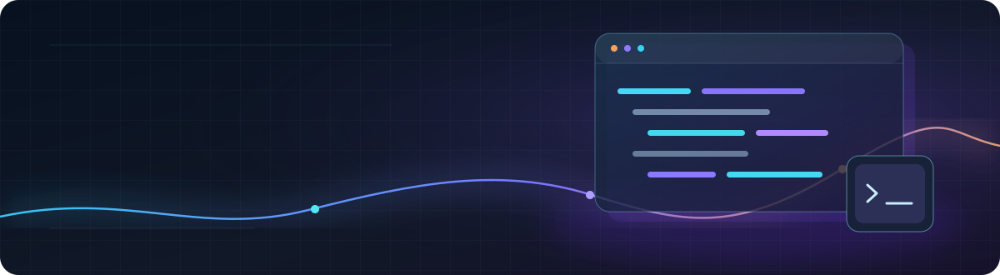

PRODUCT ENGINEERING // EGYPT · OPEN TO REMOTE COLLABORATION

# Rabea Shaban

### Full-Stack Software Engineer

**React · Next.js · TypeScript · Node.js · AWS**

I turn product ideas into reliable web applications, APIs, and cloud-ready software.

  
  
  
  
  

---

## 01 / Engineering Profile

I'm a Full-Stack Software Engineer based in Egypt. I build maintainable products across the full cycle: product interfaces, backend services, data models, integrations, and deployment.

- Freelance full-stack development for regional and international clients since 2023.
- Completed the Digilians AI-Based Software Development Specialized Diploma with distinction.
- Hands-on frontend and backend training, including Digital Fortress, Darwish & Co., and WEB MASTER.
- Interested in software architecture, cloud engineering, DevOps, and practical AI integration.

## 02 / Selected Builds

### [EduSphere](https://edusphere-theta-woad.vercel.app/) · [Source](https://github.com/rabea-shaban/EduSphere)
A learning platform with course management, live sessions, assessments, certificates, and payments.  
**Next.js · React · TypeScript · Node.js · MongoDB · Socket.IO · Stripe**

### [Pharmacy POS](https://pharmacy-pos-pharmacy-pos-frontend-ten.vercel.app/#/login) · [Source](https://github.com/rabea-shaban/-PHARMACY-POS)
Multi-branch pharmacy operations for inventory, checkout, staff access, and sales reporting.  
**React · TypeScript · Node.js · Express · Prisma · MySQL**

### [Zein Hub](https://zein-hub.vercel.app/) · [Source](https://github.com/rabea-shaban/Zein-Hub)
A training and media platform for learning programs, assignments, attendance, and certificates.  
**Next.js · React · TypeScript · Node.js · Express · MongoDB**

### [Sy2antek](https://sy2antek.vercel.app/) · [Source](https://github.com/rabea-shaban/Sa2yanti)
A vehicle-services platform for service discovery, customer booking, and operations.  
**React · TypeScript · Node.js · Express · MongoDB**

### [ImpersonaGuard](https://github.com/DigitalFortress-EG/ImpersonaGuard-)
A security-focused identity protection and risk assessment project.  
**Node.js · Express · MongoDB · REST APIs · AI integration**

## 03 / Engineering Toolkit

**Frontend**  

**Backend & Data**  

Cloud, delivery & emerging focus

**Cloud & delivery:** AWS · Docker · Kubernetes · Terraform · GitHub Actions  
**Observability:** Prometheus · Grafana  
**Engineering interests:** system design · CI/CD · infrastructure as code · AI-powered software

## 04 / Experience & Training

- **Freelance Full-Stack Software Engineer** · 2023–Present — Building and maintaining end-to-end web products for regional and international clients.
- **Frontend Developer Intern · Digital Fortress** · Sep–Nov 2026 — React and Next.js interfaces, reusable UI, and real project workflows.
- **Backend Developer Trainee · Darwish & Co.** · Sep–Nov 2026 — Node.js, Express, TypeScript, MongoDB, REST APIs, authentication, and data design.
- **Frontend Developer Intern · WEB MASTER** · May–Sep 2025 — Production React components and responsive UI improvements.
- **Founder & Frontend Lead · Beta Social** — Building digital products and software solutions for clients in Egypt and Saudi Arabia.
- **Digital Egypt Pioneers Initiative (DEPI)** · 2024 — Built AGRSUP, an agricultural e-commerce platform using React, .NET, role-based access, dashboards, and Stripe.

## 05 / Education & Credentials

- **AI-Based Software Development Specialized Diploma** · Digilians / MCIT · Egyptian Military Academy · 2026 · Completed with distinction
- **AWS Certified Developer – Associate** · AWS · 2026
- **AWS Certified Cloud Practitioner** · AWS · 2026
- **Meta Front-End Developer Professional Certificate** · Meta / Coursera
- **B.Sc. Management Information Systems** · Higher Institute of Technology, Management & Information · 2024 · Excellent

## 06 / Connect

I'm interested in useful products, thoughtful engineering teams, and remote or freelance collaborations.

[Portfolio](https://www.rabea-shaban.com/) · [LinkedIn](https://linkedin.com/in/rabea-sh-elzayat) · [Email](mailto:rabea.elzayate@gmail.com) · [Upwork](https://upwork.com/freelancers/~01d2bd68b7d6e8fbce) · [Mostaql](https://mostaql.com/u/rabea_elzayat)

نبذة بالعربي

أنا ربيع شعبان، مهندس برمجيات Full-Stack من مصر. أطور تطبيقات ويب متكاملة تجمع بين الواجهات الحديثة والخدمات الخلفية وقواعد البيانات والنشر السحابي. أتممت دبلومة Digilians في تطوير البرمجيات القائمة على الذكاء الاصطناعي بامتياز، وخضت تدريبات عملية في تطوير الواجهات والأنظمة الخلفية.

**Building dependable products with thoughtful engineering.**

